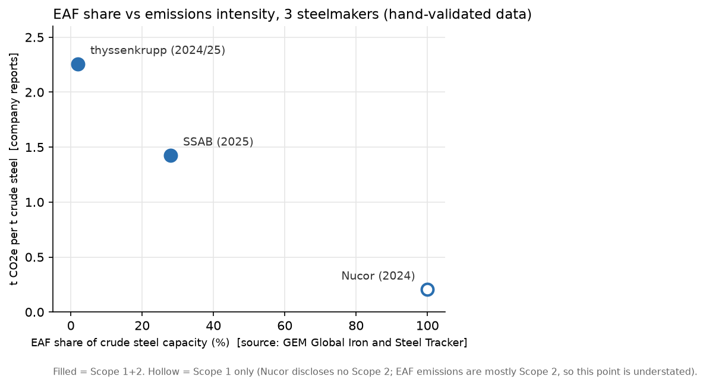
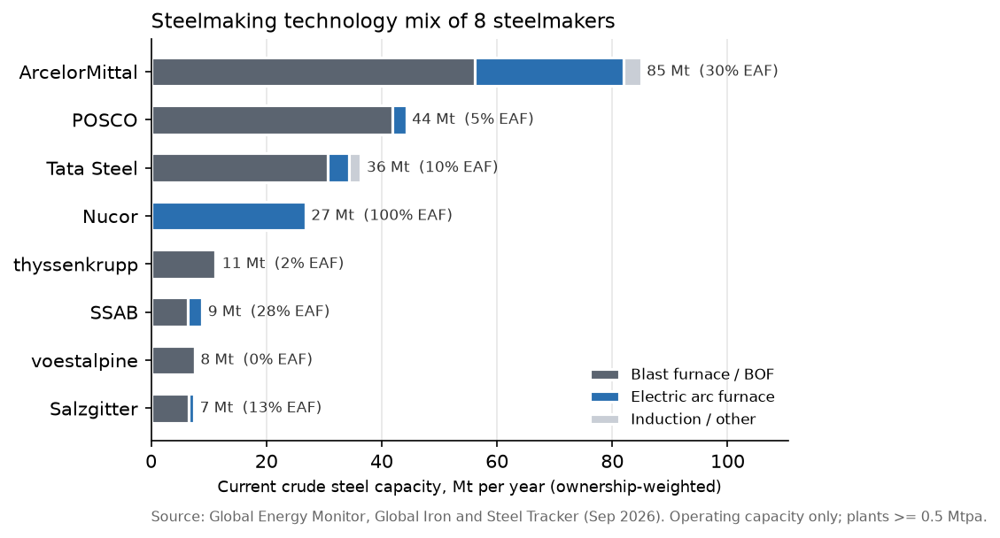

# Steel Decarbonisation Benchmark

Benchmarks 8 major steelmakers' technology mix against their emissions intensity, combining plant-level asset data with figures an LLM extracts from annual and sustainability reports, and measures how accurate that extraction is by checking every field by hand.

## Results

Blast-furnace-heavy producers (thyssenkrupp, Tata Steel, POSCO) emit 2.0-2.3 t CO2e per tonne of crude steel; companies with a mixed fleet (ArcelorMittal, Salzgitter, SSAB) 1.4-1.8; Nucor, an all-EAF producer, far less. Nucor's value covers Scope 1 only because it discloses no Scope 2 in these documents; EAF emissions are mostly Scope 2, so the real gap is smaller. Intensity is calculated as (Scope 1 + Scope 2) / crude steel from hand-validated figures; for ArcelorMittal this gives 1.78 against a company-reported 1.79.

ArcelorMittal has almost as much EAF capacity as Nucor in absolute terms (25.9 vs 26.8 Mt), although EAF is only 30% of its fleet. voestalpine shows 0% because its electric arc furnaces are still under construction.

## LLM extraction accuracy

Every extracted value was checked by hand against the source page (value, unit, reporting year, scope). "Correctly null" means the figure is not in the document and the model returned nothing instead of guessing.

| | v1 (3 companies) | v2 batch 1 (3 companies, prompt tuned on these) | v2 batch 2 (5 unseen companies) | v2 all 8 |
|---|---|---|---|---|
| Fields | 15 | 15 | 25 | 40 |
| Accuracy | 73% | 93% | 92% | 92% |
| Recall | 56% | 89% | 88% | 88% |

Accuracy holds on companies the prompt was never tuned for. All three v2 errors share one cause: the page holding the figure was never sent to the model (retrieval), not a wrong number from the model.

## Cross-check: reported production vs tracked capacity

Crude steel production from the reports divided by GIST capacity gives 78-85% utilisation for SSAB, thyssenkrupp, Nucor, Salzgitter and POSCO, a plausible range. ArcelorMittal stands out at 65%: GIST's ownership-weighted capacity likely includes joint ventures that ArcelorMittal does not consolidate in its production figure. POSCO's value mixes domestic production with group capacity including overseas plants.

## Main findings
- Most extraction errors come from retrieval (wrong pages), not the LLM. Companies label the same table differently ("Gross Scope 1 GHG emissions", "Scope 1 CO2e", "Direct emissions").
- Reports show base-year, previous-year and reporting-year columns side by side; the prompt must name the column. One table had five year columns, including restated values.
- A stricter prompt (unit always required) removed wrong answers but also dropped one correct value.
- Group CO2 intensity per tonne of steel is rarely printed; it has to be calculated, and company-reported intensities follow different methods.
- Production figures are not always comparable: Tata Steel reports crude steel for India, liquid steel for Europe and saleable steel for Thailand, so they cannot be summed.
- Unit traps: US short tons, German decimal notation (5.879,8 kt), and a published table whose header says "million t" while the figure is in tonnes.
- Reporting years differ: calendar 2025, fiscal 2024/25 (Oct-Sep), 2025/26 (Apr-Mar), and two companies with only 2024 data available.
- GIST covers plants of at least 0.5 Mtpa only; its parent field is the direct parent, not the ultimate owner.

## Method
1. **Plant database:** Global Energy Monitor's Global Iron and Steel Tracker (1,293 plants) loaded into DuckDB; raw tables untouched, clean SQL views on top. Data-quality checks: unknown capacities (">0") kept as NULL, process capacities sum to crude capacity on all checkable rows, ownership shares split and normalised. Capacity and EAF share per company are ownership-weighted.
2. **Extraction:** PyMuPDF page text, keyword-based page retrieval, then Gemini (gemini-3.6-flash for batch 1, gemini-3.7-flash for batch 2; free tier) with structured output (value, unit, year, page, quote) at temperature 0. Prompt v2 adds six rules: reporting-year column only, no targets or base years, unit as printed, group totals, no guessing.
3. **Validation:** hand check of every field against the cited page; results in `data/extracted/validation_sheet.csv` and `validation_batch2.csv`.
4. **Benchmark:** hand-validated values joined with GIST capacity and EAF share (`data/extracted/benchmark_all.csv`).

## Limits
Small sample (8 companies, 40 fields). voestalpine has no crude steel figure in its annual report, so its intensity is not shown. Mixed reporting years and boundaries are documented, not harmonised.

## Run
`python src/load_gist.py` rebuilds the database. Notebooks 01-04 contain exploration, extraction, validation and charts. Company reports are not included (copyright).

Data: Global Energy Monitor, Global Iron and Steel Tracker (CC BY 4.0); company annual and sustainability reports.
